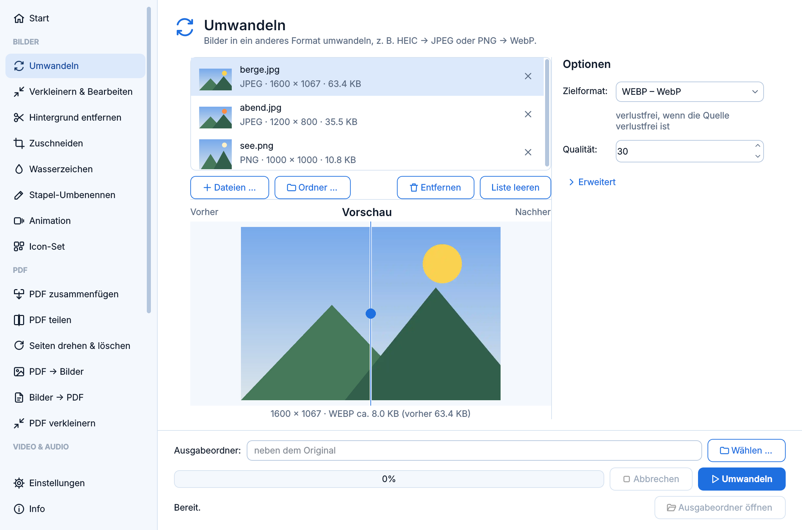

# Grafische Oberfläche

Miksan-Converter lässt sich auch ohne Kommandozeile bedienen: Dateien ins Fenster ziehen,
Werkzeug wählen, Optionen einstellen, den blauen Knopf drücken.



## Installation und Start

Die Oberfläche braucht das Extra `[gui]` (PySide6/Qt):

```bash
pip install "miksan-converter[gui]"
pip install "miksan-converter[gui,ki]"   # zusätzlich Hintergrund entfernen
```

Start:

```bash
miksan-gui                 # öffnet das Fenster
miksan-gui fotos/ bild.png # Dateien und Ordner gleich in die Liste übernehmen
miksan gui                 # dasselbe über die Kommandozeile (Alias: miksan oberflaeche)
```

Fehlt das Extra, meldet `miksan gui` das mit dem Installationsbefehl und Rückgabecode 3.

## Design

Die Oberfläche hat ein eigenes, helles Design in Blau und Weiss, das auf Windows, macOS und
Linux gleich aussieht (Qt-Stil „Fusion“ mit einem zentralen Stylesheet). Der Hauptknopf jeder
Seite ist blau gefüllt, alle anderen Knöpfe sind weiss mit blauem Rahmen; der Tastaturfokus ist
mit einem dunkleren blauen Rahmen sichtbar. Die Icons sind eigene, schlichte Linien-Icons (SVG),
die auch bei 125 %, 150 % oder 200 % Bildschirmskalierung scharf bleiben.

Für Entwickler: Farben, Abstände (8-px-Raster), Eckenradius und Schriftgrösse stehen nur in
`src/miksan_converter/gui/design.py`. Andere Dateien setzen keine Farben, sondern nur eine Rolle
(`design.eigenschaft(widget, "primaer")`, `"hinweis"`, `"fehler"` …). Die Icons liegen in
`src/miksan_converter/gui/icons/` und werden mit `design.icon("name", farbe)` geladen.

## Aufbau

Links steht die **Seitenleiste** mit allen Werkzeugen, gegliedert in Bereiche:

- **Start** – Karten für alle Werkzeuge und eine grosse Ablagefläche „Dateien hierher ziehen“.
  Nach dem Ablegen bietet die Startseite die Werkzeuge an, die zu den Dateien passen
  (z. B. bei Fotos: Umwandeln, Verkleinern & Bearbeiten, Hintergrund entfernen).
- **Bilder** – Umwandeln, Verkleinern & Bearbeiten, Hintergrund entfernen.
- unten **Einstellungen** und **Info**.

Werkzeuge, für die ein Extra fehlt (z. B. „Hintergrund entfernen“ ohne `[ki]`), sind
ausgegraut; ihre Seite nennt den Installationsbefehl. Der Rest der App läuft normal.

Jede Werkzeug-Seite ist gleich aufgebaut:

- **links** die Ablagefläche bzw., sobald Dateien da sind, die **Dateiliste** mit Miniaturbild,
  Dateiname (ganzer Pfad im Tooltip), Format, Masse und Grösse. Das **X** nimmt einen Eintrag
  heraus, „Entfernen“ alle markierten, „Liste leeren“ alle. Miniaturen werden im Hintergrund
  geladen, das Fenster bleibt bedienbar. Nach dem Lauf zeigt jede Zeile ihren Status (✓,
  Hinweis oder Fehler mit Text); bei Ordnern die Summe.
- **rechts** nur die Optionen dieses Werkzeugs; seltene Optionen stehen unter **Erweitert**.
- **unten** fest: Ausgabeordner, Fortschritt, **Abbrechen** und der blaue Hauptknopf.

Dateien kann man überall ins Fenster ziehen. Beim Wechsel des Werkzeugs bleibt die Dateiliste
erhalten, soweit die Dateien zum neuen Werkzeug passen.

## Werkzeuge

- **Umwandeln** – Zielformat und Qualität; unter „Erweitert“ maximale Grösse,
  Hintergrundfarbe (für Formate ohne Transparenz, z. B. JPEG) und Metadaten entfernen.
  Formate, die auf diesem Rechner nicht verfügbar sind, sind ausgegraut (der Tooltip sagt
  warum); unter der Auswahl stehen Einschränkungen des Formats.
- **Verkleinern & Bearbeiten** – maximale Grösse (längste Seite), Qualität, Zielgrösse
  (z. B. `500KB`), Drehen, Spiegeln, Metadaten entfernen; unter „Erweitert“ das Zielformat
  (Standard „wie Original“, es entsteht `<name>-bearbeitet` neben dem Original) und die
  Hintergrundfarbe. Die Regeln sind dieselben wie bei der Kommandozeile, siehe
  [bearbeiten.md](bearbeiten.md).
- **Hintergrund entfernen** – KI-Modell, neuer Hintergrund, Kante weicher und Zielformat
  (Standard PNG, es entsteht `<name>-freigestellt.png`), siehe unten und
  [hintergrund.md](hintergrund.md).

### Vorschau

Auf allen Bild-Werkzeugen zeigt die **Vorschau** unter der Dateiliste das
markierte Bild (bei einem Ordner das erste Bild darin) mit den aktuellen Einstellungen –
Format, Qualität, Zielgrösse, maximale Grösse, Drehen, Spiegeln, Hintergrundfarbe. Sie wird
etwa 0,3 Sekunden nach der letzten Änderung im Hintergrund neu berechnet, das Fenster bleibt
bedienbar.

- **Vorher/Nachher-Schieber**: links der Linie das Original, rechts das Ergebnis. Linie mit der
  Maus ziehen oder mit den Pfeiltasten ← → verschieben.
- **Zoom** mit dem Mausrad, gezoomt **verschieben** durch Ziehen neben der Linie,
  **Doppelklick** setzt zurück.
- Transparente Stellen erscheinen als **Schachbrettmuster** – so sieht man z. B., dass JPEG sie
  mit der Hintergrundfarbe füllt.
- Darunter: **Masse vorher → nachher** und die **geschätzte Dateigrösse** („ca.“).

Gerechnet wird mit denselben Funktionen wie beim echten Lauf, aber auf einer verkleinerten
Kopie (längste Seite höchstens 1600 Pixel). Die Dateigrösse wird aus der echten Kodierung
dieser Kopie auf die volle Grösse hochgerechnet und ist deshalb eine Schätzung. Die Vorschau
schreibt nie eine Datei.

Der Hauptknopf startet die Verarbeitung im Hintergrund (parallel), das Fenster bleibt
bedienbar. **Abbrechen** startet keine weiteren Dateien mehr; Dateien, die gerade laufen,
werden noch fertig. Danach steht die Zusammenfassung unter dem Balken (z. B. „Fertig: 12 ok,
1 Fehler, 2 Hinweise“), darunter die Fehler und Hinweise pro Datei. **Ausgabeordner öffnen**
zeigt die Ergebnisse im Dateimanager.

## Einstellungen und Info

- **Einstellungen** (gelten für alle Werkzeuge, werden sofort gespeichert):
  Standard-Ausgabeordner (leer = neben dem Original; ein Ordner unten auf einer Werkzeug-Seite
  hat Vorrang), vorhandene Dateien überschreiben, Unterordner einbeziehen (die Ordnerstruktur
  bleibt im Ausgabeordner erhalten), Ordner der KI-Modelle mit „Ordner öffnen“ und
  „Modelle löschen“.
- **Info**: Version, Lizenz, genutzte Bibliotheken, Link zum Repo. Miksan-Converter arbeitet
  lokal – ohne Cloud, ohne Werbung, ohne Telemetrie.

## Tastenkürzel

| Taste | Wirkung |
|---|---|
| Strg+O | Dateien hinzufügen |
| Entf | markierte Einträge entfernen |
| Strg+Enter | starten |
| Esc | abbrechen |

### Hintergrund entfernen

Die Modellauswahl zeigt Name, Zweck und Grösse und ob das Modell schon geladen ist. Fehlt es,
lädt der Knopf **Herunterladen** es einmalig mit Fortschrittsbalken; erst danach lässt sich
freistellen – es gibt keine Abfrage mitten im Lauf. Im Windows-Installer ist das Modell
„klein“ schon enthalten. Neuer Hintergrund (Transparent, Farbe, eigenes Bild,
weichgezeichnetes Original) und „Kante weicher“ wirken sofort in der Vorschau, siehe
[hintergrund.md](hintergrund.md).

## Einstellungen merken

Jedes Werkzeug merkt sich seine zuletzt gewählten Einstellungen (Zielformat, Ausgabeordner,
Bearbeitungsoptionen, Farbe, Modell) über `QSettings`. Einstellungen aus Version 0.2 werden
weiter gelesen und gehen nicht verloren:

| System | Ort |
|---|---|
| Windows | Registry, `HKEY_CURRENT_USER\Software\Miksan\Miksan-Converter` |
| macOS | `~/Library/Preferences/com.miksan.Miksan-Converter.plist` |
| Linux | `~/.config/Miksan/Miksan-Converter.conf` |

Die Dateiliste selbst wird nicht gespeichert.

## Technik

Die Oberfläche nutzt dieselben Funktionen wie die Kommandozeile (`stapel.dateien_sammeln`,
`auftraege_planen`, `ausfuehren` mit `convert.umwandeln`, `convert.bearbeiten` und
`hintergrund.hintergrund_entfernen`). Ergebnisse sind daher identisch zu
`miksan convert … --to … -o …`.

Aufbau des Codes in `src/miksan_converter/gui/`: `fenster.py` (Rahmen und Seitenleiste),
`werkzeuge.py` (zentrale Werkzeug-Registrierung: Name, Icon, Bereich, Seite, benötigtes Extra),
`seiten/` (eine Datei pro Werkzeug, gemeinsame Basis in `seiten/basis.py`), `widgets/`
(Ablagefläche, Dateiliste, Miniaturen, Ablaufleiste), `logik.py` und `dateiinfo.py` (ohne Qt,
normal testbar), `design.py` (Farben, Masse, Stylesheet, Icons).
