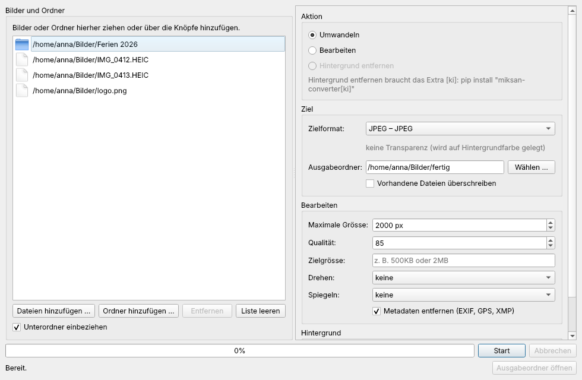

# Grafische Oberfläche

Miksan-Converter lässt sich auch ohne Kommandozeile bedienen: Bilder oder Ordner ins Fenster
ziehen, Aktion und Zielformat wählen, **Start** drücken.



## Installation und Start

Die Oberfläche braucht das Extra `[gui]` (PySide6/Qt):

```bash
pip install "miksan-converter[gui]"
pip install "miksan-converter[gui,ki]"   # zusätzlich Hintergrund entfernen
```

Start:

```bash
miksan-gui                 # öffnet das Fenster
miksan-gui fotos/ bild.png # Dateien und Ordner gleich in die Liste übernehmen
miksan gui                 # dasselbe über die Kommandozeile (Alias: miksan oberflaeche)
```

Fehlt das Extra, meldet `miksan gui` das mit dem Installationsbefehl und Rückgabecode 3.

## Bedienung

1. **Bilder und Ordner hinzufügen** – per Drag & Drop in die Liste (oder irgendwo ins Fenster)
   oder mit „Dateien hinzufügen …“ bzw. „Ordner hinzufügen …“. „Entfernen“ nimmt die markierten
   Einträge heraus, „Liste leeren“ alle. Mit **Unterordner einbeziehen** werden Ordner rekursiv
   durchsucht; die Ordnerstruktur bleibt im Ausgabeordner erhalten.
2. **Aktion wählen**
   - **Umwandeln** – in das gewählte Zielformat, optional mit Bearbeitung.
   - **Bearbeiten** – Zielformat „wie Original“ behält das Format; es entsteht
     `<name>-bearbeitet` neben dem Original.
   - **Hintergrund entfernen** – mit lokalem KI-Modell (Extra `[ki]`), es entsteht
     `<name>-freigestellt.png`. Ist das Extra nicht installiert, ist die Aktion ausgegraut und
     ein Hinweis nennt den Installationsbefehl.
3. **Ziel**
   - **Zielformat** – alle Formate, die Miksan-Converter schreiben kann. Formate, die auf
     diesem Rechner nicht verfügbar sind, sind ausgegraut (der Tooltip sagt warum). Unter der
     Auswahl stehen Einschränkungen des Formats.
   - **Ausgabeordner** – leer bedeutet „neben dem Original“.
   - **Vorhandene Dateien überschreiben** – sonst wird eine vorhandene Zieldatei als Fehler
     gemeldet und nicht verändert.
4. **Bearbeiten** (bei Umwandeln und Bearbeiten): maximale Grösse (längste Seite), Qualität,
   Zielgrösse (z. B. `500KB`), Drehen, Spiegeln, Metadaten entfernen. Die Regeln sind dieselben
   wie bei der Kommandozeile, siehe [bearbeiten.md](bearbeiten.md).
5. **Hintergrund**: Hintergrundfarbe für Formate ohne Transparenz (z. B. JPEG) über den
   Farbwähler; bei „Hintergrund entfernen“ zusätzlich das KI-Modell (siehe
   [hintergrund.md](hintergrund.md)).
6. **Start** – die Dateien werden im Hintergrund verarbeitet (parallel), das Fenster bleibt
   bedienbar. Der Balken zeigt den Fortschritt. **Abbrechen** startet keine weiteren Dateien
   mehr; Dateien, die gerade laufen, werden noch fertig.

Danach steht die Zusammenfassung unter dem Balken (z. B. „Fertig: 12 ok, 1 Fehler,
2 Hinweise“), darunter die Liste der Fehler und Hinweise pro Datei. **Ausgabeordner öffnen**
zeigt die Ergebnisse im Dateimanager.

### Hintergrund entfernen zum ersten Mal

Beim ersten Gebrauch eines Modells fragt das Fenster nach, bevor das Modell **einmalig aus dem
Internet** geladen wird (je nach Modell etwa 5 bis 200 MB). Es wird im üblichen Modellordner
gespeichert (siehe [hintergrund.md](hintergrund.md)) und danach offline genutzt.

## Einstellungen merken

Das Fenster merkt sich die zuletzt gewählten Einstellungen (Aktion, Zielformat je Aktion,
Ausgabeordner, Bearbeitungsoptionen, Farbe, Modell) über `QSettings`:

| System | Ort |
|---|---|
| Windows | Registry, `HKEY_CURRENT_USER\Software\Miksan\Miksan-Converter` |
| macOS | `~/Library/Preferences/com.miksan.Miksan-Converter.plist` |
| Linux | `~/.config/Miksan/Miksan-Converter.conf` |

Die Dateiliste selbst wird nicht gespeichert.

## Technik

Die Oberfläche nutzt dieselben Funktionen wie die Kommandozeile (`stapel.dateien_sammeln`,
`auftraege_planen`, `ausfuehren` mit `convert.umwandeln`, `convert.bearbeiten` und
`hintergrund.hintergrund_entfernen`). Ergebnisse sind daher identisch zu
`miksan convert … --to … -o …`.
